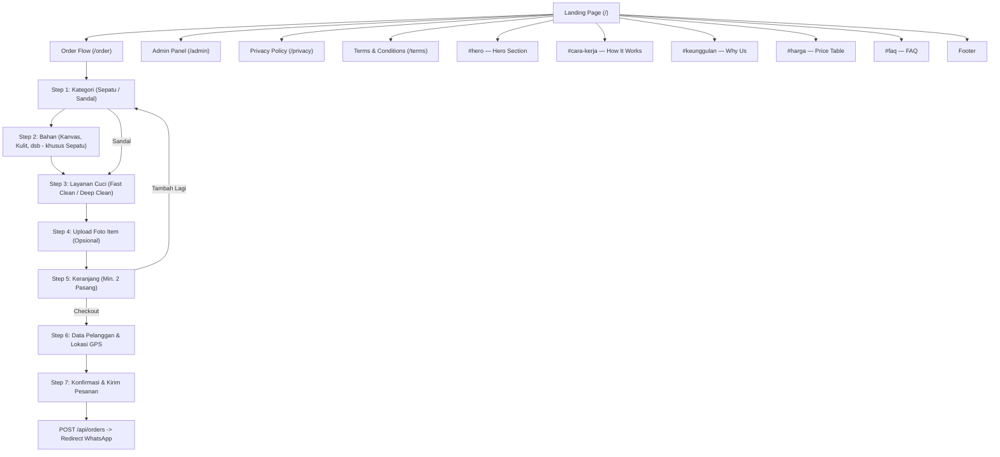
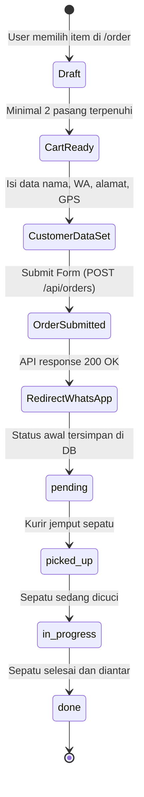

# WashPass — Application Flow (APP-FLOW)

Dokumentasi arsitektur alur pengguna, peta situs, state navigasi, dan interaksi halaman WashPass.

## 1. Sitemap & Route Hierarchy

## 2. Order Lifecycle State Machine

## 3. Wireframes & Layout Overview

### 3.1 Landing Page (`/` / `index.html`)
- **Navbar**: Sticky, transparent to solid on scroll, dynamic offset (`ResizeObserver`), menu hamburger mobile, logo, navigasi section, CTA "Pesan Sekarang".
- **Hero**: Catchy headline, CTA button link `/order`, badge trust `500+ Sepatu Dicuci` & `4.9 Rating`.
- **Cara Kerja (3 Langkah)**: Pesan Online → Kurir Jemput → Bersih & Antar Kembali.
- **Keunggulan**: Free Pickup & Delivery, Pembersih Profesional, Transparan, Garansi Kepuasan.
- **Tabel Harga**: Toggle tab Sepatu vs Sandal, matrix bahan vs jenis cuci, link langsung isi keranjang.
- **FAQ**: Accordion interaktif (1 open at a time).
- **Footer**: Brand info, jam operasional, link kebijakan (`/privacy`, `/terms`), kontak WhatsApp & media sosial.

### 3.2 Order Flow (`/order` / `order.html`)
Container dinamis single container dengan step progress indicator bar di bagian atas:
1. **Pilih Kategori**: 👟 Sepatu atau 🩴 Sandal.
2. **Pilih Bahan** (Bypass jika Sandal): Kanvas, Mesh/Knit, Kulit, Suede/Nubuck, Rubber/EVA.
3. **Pilih Tipe Cuci**: Fast Clean (kering, 1–2 hari) vs Deep Clean (basah, 3–5 hari).
4. **Upload Foto**: Multi-file dropzone dengan kompresi client-side (Canvas API) sebelum payload dikirim.
5. **Review Keranjang**: Validasi total item $\ge 2$. Kemampuan tambah pasang lain atau edit/hapus item.
6. **Form Data Diri**:
   - Nama lengkap
   - Nomor WhatsApp aktif
   - Alamat lengkap + catatan patokan
   - Tombol "Gunakan Lokasi Saat Ini" (Browser Geolocation API + reverse geocoding Nominatim OSM)
7. **Review & Konfirmasi**:
   - Rincian pesanan, biaya total, estimasi waktu
   - Tombol "Kirim Pesanan" (menjalankan AJAX POST multipart form ke server, lalu membuka template teks WhatsApp ke admin).

### 3.3 Admin Panel (`/admin` / `admin.html`)
- **Dashboard Summary**: Total order, status breakdown (`pending`, `picked_up`, `in_progress`, `done`).
- **Tabel Pesanan**: Kolom ID, tanggal, nama, WA (direct link WhatsApp), item count, total harga, status badge, action button.
- **Detail Modal**:
   - Data pelanggan lengkap
   - Titik koordinat via Leaflet.js interactive map view
   - Daftar item cuci beserta foto kondisi sepatu (thumbnail click to full preview)
   - Form transisi status pesanan (`PATCH /api/orders/:id/status`)

## 4. Interaction Rules & Edge Cases

| Skenario | Penanganan |
|---|---|
| User refresh halaman saat order | State keranjang tersimpan di `localStorage`, form state ter-hydrate |
| Total order kurang dari 2 pasang | Tombol submit disable + tampil warning alert |
| Ukuran foto > 5MB | Ditangkap client-side dan dikompres otomatis via Canvas API |
| Server API offline saat order | Fallback manual: generate teks order WhatsApp langsung ke `wa.me` |
| Geolocation ditolak pengguna | Form alamat tetap bisa diisi manual tanpa kendala |
| Status transisi tidak valid | Server menolak (`400 Bad Request`) memastikan siklus status urut |
