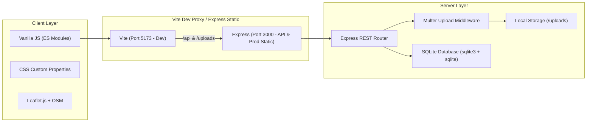

# WashPass — Technical Requirements Document (TRD)

Spesifikasi teknis, arsitektur sistem, stack dependensi, skema basis data, dan antarmuka API.

## 1. System Architecture

## 2. Tech Stack Specification

| Komponen | Pilihan | Rasional & Deskripsi |
|---|---|---|
| **Frontend Framework** | Vanilla JS (ES2022+) | Multi-page aplikasi tanpa overhead runtime library besar. |
| **Bundler** | Vite 5 | Fast HMR dev server, optimal production rollup bundling. |
| **Styling** | Native CSS Variables + BEM Hybrid | Ringan, 0 dependency build, performa rendering instan. |
| **Typography** | Plus Jakarta Sans (Headings), Inter (Body) | Google Fonts web font standar readability tinggi. |
| **Icons** | Lucide Icons | Inline SVG icons. |
| **Maps & Lokasi** | Leaflet.js + Nominatim OSM | Open-source map tile tanpa biaya API key berbayar. |
| **Client Compression**| HTML5 Canvas API | Resize & convert JPEG di browser sebelum transmisi HTTP multipart. |
| **Runtime & Server** | Node.js (20+) + Express.js | Standardized JavaScript end-to-end. |
| **Database** | SQLite (`sqlite3` + `sqlite` wrapper) | File-based asynchronous SQLite engine yang kompatibel dengan modern Node runtime. |
| **Upload Handler** | Multer | Menangani streaming file multipart disk-storage lokal. |

## 3. Database Schema

### `orders`
| Kolom | Tipe | Constraint | Deskripsi |
|---|---|---|---|
| `id` | INTEGER | PRIMARY KEY AUTOINCREMENT | ID order |
| `customer_name` | TEXT | NOT NULL | Nama pemesan |
| `whatsapp` | TEXT | NOT NULL | Nomor kontak WhatsApp |
| `address` | TEXT | NOT NULL | Alamat penjemputan |
| `address_note` | TEXT | NULL | Catatan patokan/lokasi |
| `latitude` | REAL | NULL | Titik lintang GPS browser |
| `longitude` | REAL | NULL | Titik bujur GPS browser |
| `status` | TEXT | NOT NULL DEFAULT 'pending' | Enum: `pending`, `picked_up`, `in_progress`, `done` |
| `total_price` | INTEGER | NOT NULL | Total tagihan rupiah |
| `total_items` | INTEGER | NOT NULL | Jumlah pasang |
| `created_at` | TEXT | DEFAULT `datetime('now','localtime')` | Waktu order dibuat |
| `updated_at` | TEXT | DEFAULT `datetime('now','localtime')` | Terakhir diupdate |

### `order_items`
| Kolom | Tipe | Constraint | Deskripsi |
|---|---|---|---|
| `id` | INTEGER | PRIMARY KEY AUTOINCREMENT | ID item |
| `order_id` | INTEGER | NOT NULL, FK(`orders.id`) | Relasi pesanan induk |
| `category` | TEXT | NOT NULL | `shoe` atau `sandal` |
| `material` | TEXT | NULL | Jenis bahan sepatu |
| `wash_type` | TEXT | NOT NULL | `fast-clean` atau `deep-clean` |
| `price` | INTEGER | NOT NULL | Harga per pasang |
| `notes` | TEXT | NULL | Catatan kondisi sepatu |

### `order_photos`
| Kolom | Tipe | Constraint | Deskripsi |
|---|---|---|---|
| `id` | INTEGER | PRIMARY KEY AUTOINCREMENT | ID foto |
| `order_item_id` | INTEGER | NOT NULL, FK(`order_items.id`)| Relasi item sepatu |
| `filename` | TEXT | NOT NULL | Nama file di folder `uploads/` |
| `original_name`| TEXT | NOT NULL | Nama file asli dari user |
| `size_bytes` | INTEGER | NULL | Ukuran file dalam byte |
| `created_at` | TEXT | DEFAULT `datetime('now','localtime')` | Waktu upload |

## 4. API Endpoints Contract

### 4.1 Orders API
- `POST /api/orders`
  - Content-Type: `multipart/form-data`
  - Fields: `customer_name`, `whatsapp`, `address`, `address_note`, `latitude`, `longitude`, `total_price`, `total_items`, `items` (JSON stringified), `photos` (binary files).
  - Response: `{ orderId: <number>, status: "success" }`
- `GET /api/orders`
  - Query: `?status=<status>`
  - Response: Array ringkasan order urut tanggal terbaru.
- `GET /api/orders/:id`
  - Response: Detail pesanan lengkap termasuk array items dan tautan foto.
- `PATCH /api/orders/:id/status`
  - Body: `{ "status": "picked_up" | "in_progress" | "done" }` (transisi maju saja: pending→picked_up→in_progress→done)
  - Response: `{ success: true, status: "<status>" }`

### 4.2 Static Assets
- `GET /uploads/:filename` -> File gambar foto pesanan.
