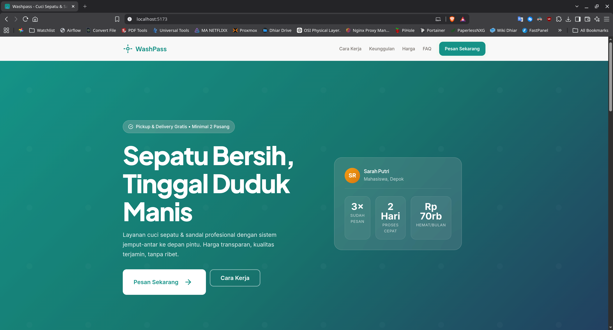
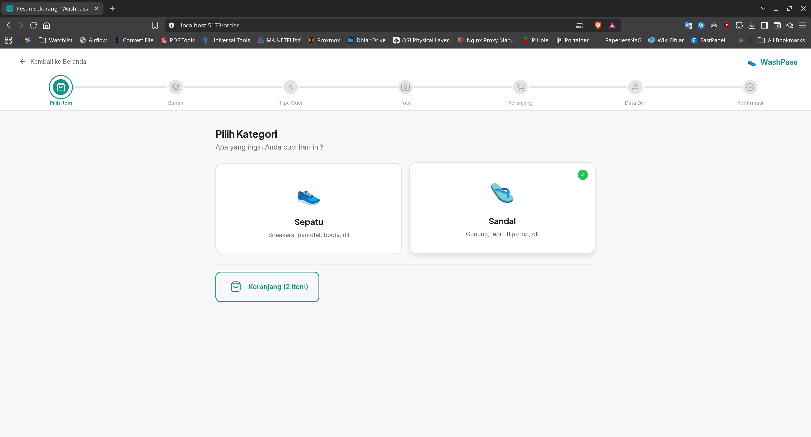
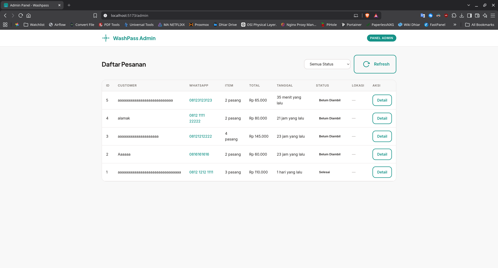

# WashPass

Website jasa cuci sepatu & sandal profesional dengan sistem pickup & delivery.

## Status

**Live Demo (branch `demo`)** — versi demo publik yang sepenuhnya statis: semua data order (buat, lacak, kelola admin) dimock di `localStorage`, tanpa backend/database. Siap deploy ke Cloudflare Pages dari hasil build `dist/`.

Versi full-stack asli (Express + SQLite) tetap tersedia di branch lain; kode backend `server/` dipertahankan di repo ini sebagai referensi tapi tidak di-deploy.

See [`docs/CHANGELOG.md`](./docs/CHANGELOG.md) for version history and changelog.

See [`.ai/IMPLEMENTATION-PLAN.md`](./.ai/IMPLEMENTATION-PLAN.md) for detailed feature documentation, known issues, and action items.

Dokumentasi arsitektur dan spesifikasi teknis:
- [`.ai/APP-FLOW.md`](./.ai/APP-FLOW.md) — Alur pengguna, wireframe & sitemap
- [`.ai/TRD.md`](./.ai/TRD.md) — Technical requirements & API specification
- [`.ai/DESIGN.md`](./.ai/DESIGN.md) — Design system & UI tokens
- [`.ai/PRD.md`](./.ai/PRD.md) — Product requirement document
- [`AGENTS.md`](./AGENTS.md) — Panduan agen AI & standar testing Brave browser

## Screenshots

Click an image to view it in fullscreen.

<div align="center">
  <table>
    <tr>
      <td align="center">
        <a href="pics/landing_page.png"></a><br>
        <strong>Landing Page</strong>
      </td>
      <td align="center">
        <a href="pics/order.png"></a><br>
        <strong>Order Flow</strong>
      </td>
      <td align="center">
        <a href="pics/admin.png"></a><br>
        <strong>Admin Panel</strong>
      </td>
    </tr>
  </table>
</div>

## Pages

| URL | Description |
|-----|-------------|
| `/` | Landing page |
| `/order` | Order flow |
| `/track` | Lacak status pesanan (input nomor pesanan) |
| `/admin` | Admin panel |
| `/privacy` | Privacy policy |
| `/terms` | Terms & conditions |
| `/404` | Halaman tidak ditemukan (fallback) |

## Development

```bash
# Install dependencies
pnpm install

# Frontend dev server (Vite on port 5173) — semua fitur jalan via mock localStorage
pnpm run dev

# Quality checks
pnpm run lint          # ESLint
pnpm run format        # Prettier (write)
pnpm run format:check  # Prettier (check)
pnpm test              # Vitest
```

<details>
<summary>Perintah backend full-stack (hanya di branch dengan Express/SQLite)</summary>

```bash
pnpm run dev:all       # Frontend + backend bersamaan
pnpm run dev:server    # Backend Express saja (port 3000)
pnpm run start         # Production server (dist/ + API)
```

Di branch demo ini `pnpm run dev` tidak butuh backend — `src/js/services/api.js` sudah dimock penuh.
</details>

## Tech Stack

- **Frontend**: Vite + Vanilla JS (ES Modules)
- **Data (demo)**: Mock API di `localStorage` (seed 10 order, foto data-URL, reset dari `/admin`)
- **Backend (referensi, tidak di-deploy)**: Express.js + SQLite (`sqlite3` + `sqlite`), helmet + rate limiting
- **Upload (demo)**: kompresi Canvas API client-side → data URL di localStorage
- **Maps**: Leaflet.js + OpenStreetMap
- **Location**: Browser Geolocation API + Nominatim reverse geocoding
- **CSS**: Vanilla CSS + Custom Properties (Design Tokens)
- **Fonts**: Plus Jakarta Sans + Inter (Google Fonts)
- **Tooling**: ESLint + Prettier + Vitest
- **Hosting target**: Cloudflare Pages (output build `dist/`, clean URLs `*.html` + `404.html` otomatis)

## Deploy (Cloudflare Pages)

```bash
pnpm run build        # hasil: dist/
```

- Build command: `pnpm run build` — Output directory: `dist`
- Pages otomatis menyajikan `/order` dari `order.html` (dan seterusnya) + `404.html` sebagai fallback.
- Sebelum live publik: ganti domain placeholder di `public/sitemap.xml` & `public/robots.txt`.
- `VITE_WHATSAPP_MOCK` default `true` (demo); set `false` + isi `VITE_WHATSAPP_NUMBER` bila ingin redirect `wa.me` nyata.

## Next Steps

1. Deploy `dist/` ke Cloudflare Pages (ganti domain placeholder di `sitemap.xml` & `robots.txt`).
2. **P6 — Brand Assets**: logo SVG, ilustrasi hero, ikon material & step (skill `design`).
3. **Full-stack / P7 — ditunda**: gabung ke branch backend (Express + SQLite) untuk launch produksi; Payment Gateway Midtrans Snap, auth admin, notifikasi.

Lihat [`.ai/IMPLEMENTATION-PLAN.md`](./.ai/IMPLEMENTATION-PLAN.md) untuk status terkini.
